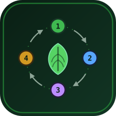
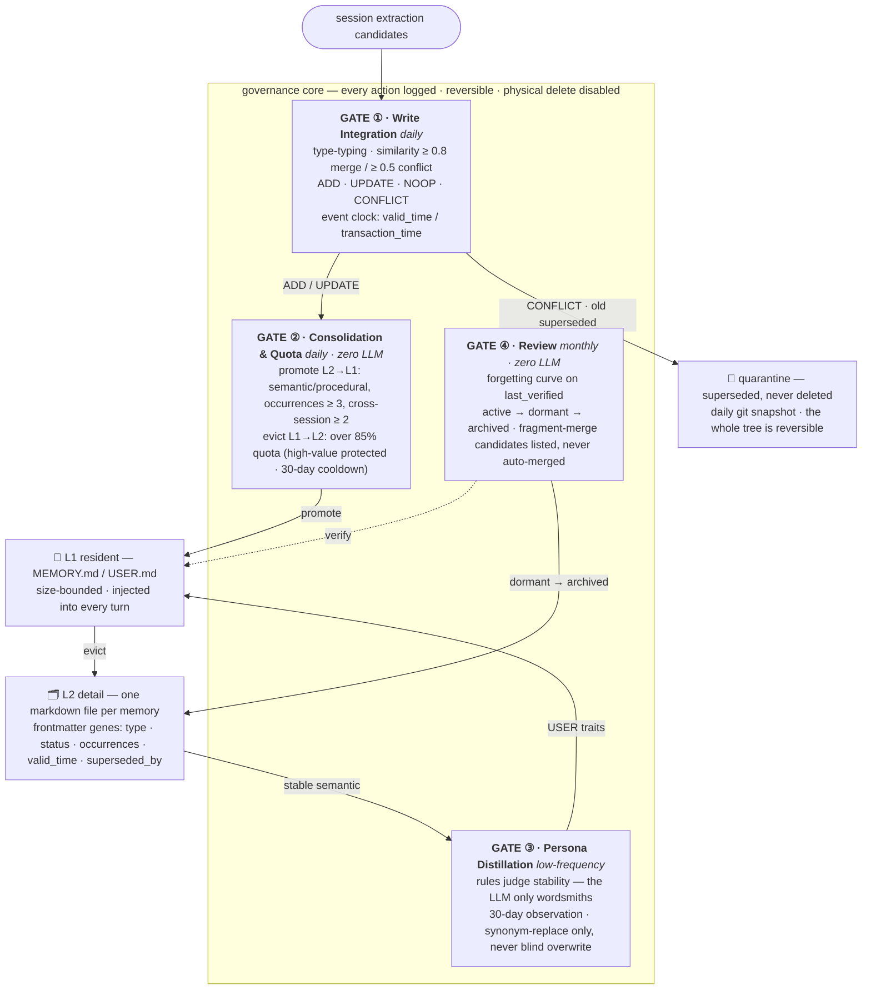
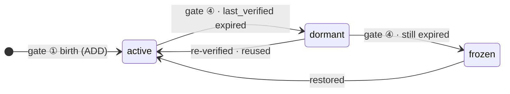
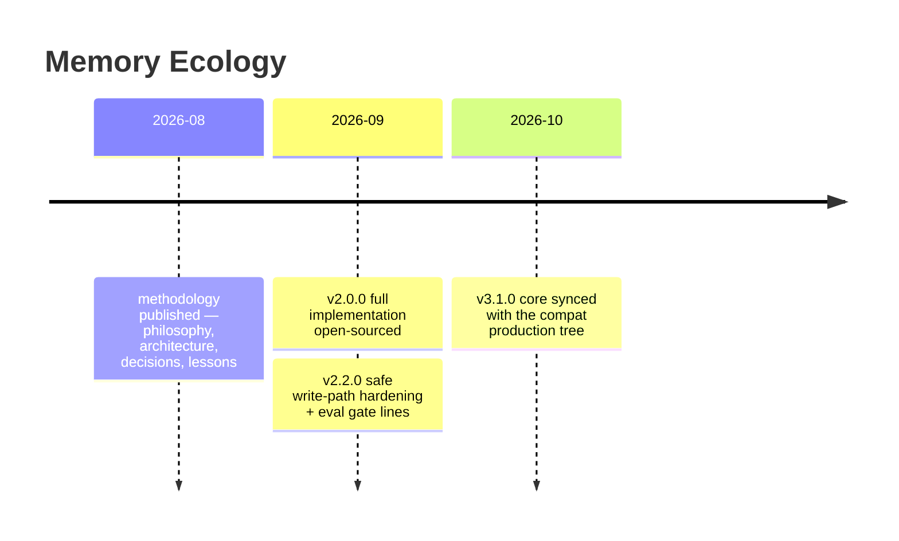

<div align="center">



# Memory Ecology

**记忆不是库存，是生态。**
*A lifecycle approach to agent memory — memory is not a warehouse, it is an ecosystem.*

[](CHANGELOG.md)
[]()
[](LICENSE)
[]()
[]()
[]()

`4 gates` · `2 axes` · `0 core dependencies` · `0 statistical calibration`

</div>

---

Most agent-memory systems today are **engines** — they answer *"how do we store and recall more?"*
(TencentDB Agent Memory, mem0, Zep, Letta, MemOS, …). This project answers the question one layer
down: **who governs the life and death of what's already stored?**

> The hard problem is not storing more. It is **governance** — birth, life, death, and evolution
> of memories, in a single-user, zero-maintenance environment.

## 🔄 The lifecycle in one look



## 🧭 Two-axis state machine

Memories live on two orthogonal axes — **activity** (an environment question: is it being used?)
and **fate** (a value question: has it been replaced?). Activity moves are reversible; fate moves
are one-way but always traceable.



| `status \ fate` | retained | superseded | archived |
|---|:---:|:---:|:---:|
| **active** | ✅ | — | — |
| **dormant** | ✅ | ✅ | — |
| **frozen** | ✅ | — | ✅ |

Illegal combinations raise a health-check alarm; `status` is authoritative, directories are just views.

## ⚡ What is different

| | Typical memory engine | Memory Ecology |
|---|---|---|
| Core question | ❌ how to store &amp; recall more | ✅ how to stay **alive *and* bounded** forever |
| Lifecycle | ❌ none — memories accumulate | ✅ two-axis state machine, four automated gates |
| Evolution | ❌ manual, or on a roadmap | ✅ rule-driven: co-occurrence → variant → evaluation → replace / coexist / archive |
| Deletion | ❌ hard delete (or neglect) | ✅ **never delete** — superseded marks + quarantine + git snapshots |
| Maintenance | ❌ operator-curated | ✅ **zero user maintenance** — thresholds self-apply |
| Calibration | ❌ statistical, needs data volume | ✅ rules + conservative thresholds + reversible fallbacks, works at N=1 |
| Evaluation | ❌ public-dataset benchmarks | ✅ five-dimension health eval adapted to single-user reality |

<details>
<summary><b>🧬 Frontmatter genes — the metadata every memory carries</b></summary>

| Field | Meaning |
|---|---|
| `type` | `semantic` (long-term fact) / `episodic` (one-off event) / `procedural` (how-to) / `lesson` |
| `status` | activity axis: `active` / `dormant` / `superseded` |
| `occurrences` / `session_count` | how often seen / across how many sessions (consolidation evidence) |
| `valid_time` / `transaction_time` | event clock: when the fact became true / when it was written (conflict adjudication basis) |
| `last_verified` | forgetting-curve anchor for gate ④ |
| `origin_session_id` | provenance — which session it came from |
| `superseded_by` | replacement lineage — a rollback-able bloodline |

</details>

<details>
<summary><b>🩺 Five-dimension health evaluation (single-user adapted LongMemEval)</b></summary>

| Dimension | Checks | Passing line |
|---|---|---|
| IE · information extraction | 7-day pipeline has logs, zero failures | ≥ 1 log, 0 failures |
| MR · multi-session reasoning | cross-session topic hit rate in memory store | ≥ 60% |
| KU · knowledge update | conflict/update actions counted (superseding works) | ≥ 1 |
| TR · temporal reasoning | event-clock field coverage | transaction 100% · valid ≥ 50% |
| ABS · safe abstention | sampled resident entries judged stale/suspect | sample ≥ 3, rate ≤ 30% |

Gates judge pass/fail — no "improvement curve" narrative, consistent with *automation ≠ statistical calibration*.

</details>

## 🚀 Quick start

```bash
git clone https://github.com/Wind-Leaves-Echo-Guqin/memory-ecology.git
cd memory-ecology

# 1) clean-room suite — mock LLM, zero dependencies, runs anywhere
python -m unittest discover tests
```

```text
Ran 4 tests in 0.094s
OK
```

```bash
# 2) poke a gate (read-only search over the memory store)
cd src/memory_ecology
python eco_search.py --help

# 3) read the methodology before wiring anything
#    docs/philosophy.md → docs/architecture.md
```

- Data root defaults to the install location; `MEMORY_ECOLOGY_ROOT` overrides for multi-instance setups.
  Thresholds ship with conservative defaults — see [`config.example.yaml`](config.example.yaml).
- Gates ① and ③ call an LLM (DeepSeek-compatible endpoint; key via `MEMORY_ECOLOGY_API_KEY` or `.env`,
  base URL configurable). Everything else is pure rules and runs offline.
- Host wiring (session extraction, injection hooks) is the **integration layer** — reference adapters
  live in the compat repo's `integrations/`.

## 📋 Gate reference

| Gate | Script | Cadence | LLM | Decides | Reversible via |
|---|---|---|---|---|---|
| ① Write Integration | `write_gate.py` | daily | adjudicates similar/conflict only (rule fallback) | `ADD` / `UPDATE` / `NOOP` / `CONFLICT` | superseded mark → quarantine + git snapshot |
| ② Consolidation &amp; Quota | `eco_quota.py` | daily | **none** | promote L2→L1 · evict over 85% quota | `.bak` backups; demotion never loses content |
| ③ Persona Distillation | `distill_stage.py` | low-frequency | wording only (rules judge stability) | USER-trait promotion after 30-day observation | previous USER text → quarantine |
| ④ Review | `eco_review.py` | monthly | **none** | forgetting curve · merge candidates (listed, human decides) | every transition logged &amp; undoable |

## 📐 Design principles

1. **Evolution is the goal; management is the means.**
2. **User maintenance burden = zero** — annual confirmations skippable, reports ignorable.
3. **Rules + conservative thresholds + reversible fallbacks** — automation ≠ statistical calibration.
4. **Everything reversible** — git snapshots + operation logs + quarantine.
5. **Mechanisms over protocols** — anything proven unreliable by hand gets mechanized.
6. **Composition over accumulation** — ecology over stacking.
7. **Protected zones** (core / buffer / experimental) — immune to structural actions, never to content updates.

Full reasoning: [`docs/philosophy.md`](docs/philosophy.md) · decisions &amp; rejections: [`docs/decisions.md`](docs/decisions.md) · field lessons: [`docs/lessons.md`](docs/lessons.md)

## 🗂 Repository layout

| Path | Content |
|---|---|
| [`docs/`](docs) | Methodology — philosophy · architecture · decisions · lessons |
| `src/memory_ecology/` | The 9 governance scripts + shared `lib/` (config / fs / gatekit / llm / memstore / metrics / pii / similarity / cli_base / safeio / inject_gate) |
| [`tests/test_cleanroom.py`](tests/test_cleanroom.py) | Zero-dependency clean-room suite (mock LLM, fixture isolation) |
| [`config.example.yaml`](config.example.yaml) | Configuration template, conservative defaults |
| [`CHANGELOG.md`](CHANGELOG.md) | Version history |

## 🧬 Two repositories, one lineage

| | This repo (`memory-ecology`) | [`memory-ecology-compat`](https://github.com/Wind-Leaves-Echo-Guqin/memory-ecology-compat) |
|---|---|---|
| Role | Core governance layer — methodology + four-gate reference implementation | Multi-host derivative — portable core + host adapters |
| Extra surface | — | retrieval consumer (`memory_query`) · experience notebook · backup · local GUI · dsh / Hermes adapters |
| Versioning | aligned with compat since v2.1.2 — currently **v3.1.0** | production tree; this repo's core mirrors it |

## 📅 Milestones



Full history: [`CHANGELOG.md`](CHANGELOG.md)

## 🙏 Acknowledgments &amp; references

- Design discussions informed by [TencentDB Agent Memory](https://github.com/TencentCloud/TencentDB-Agent-Memory), mem0, Zep/Graphiti, Letta (MemGPT), LangMem, Hindsight, OpenViking, Karpathy's LLM Wiki.
- Built and validated on [Hermes Agent](https://hermes-agent.nousresearch.com/) (Nous Research).

## 📄 License

MIT © Wind-Leaves-Echo-Guqin

<div align="center">

**记忆不是库存，是生态。**

</div>
