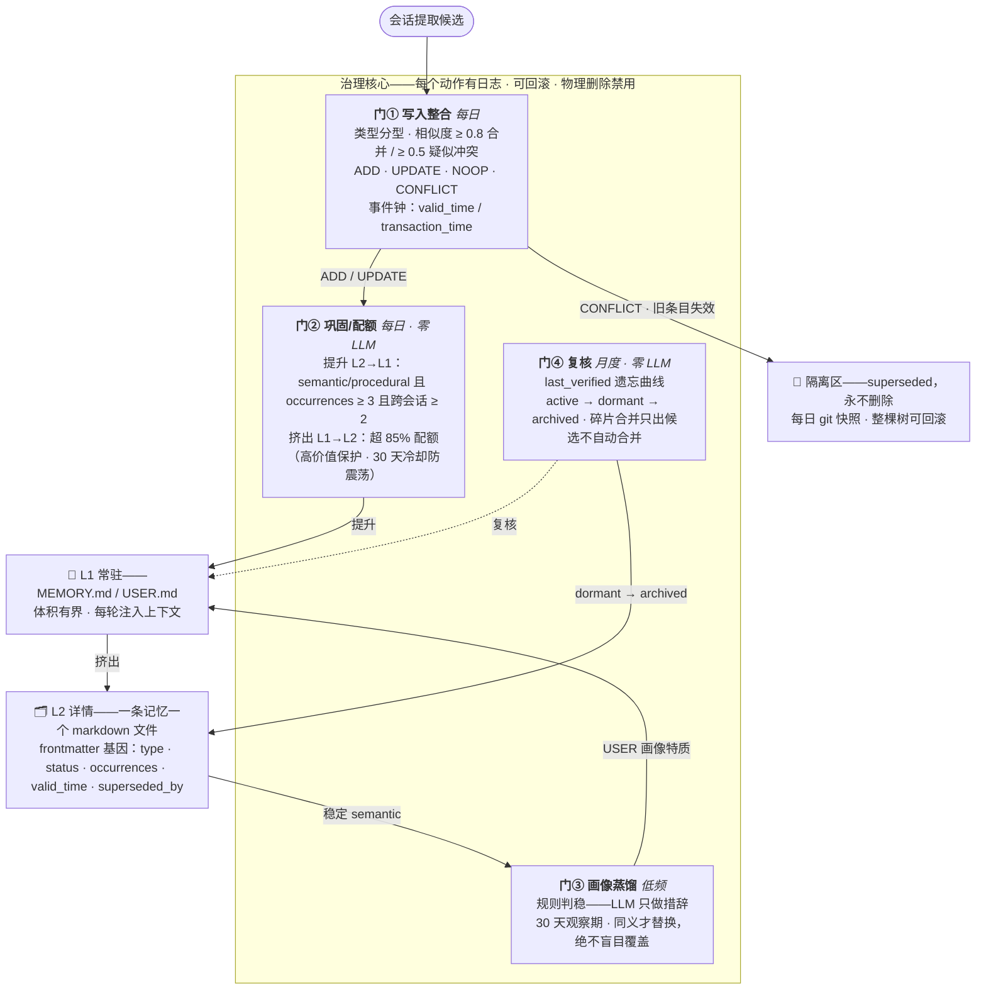
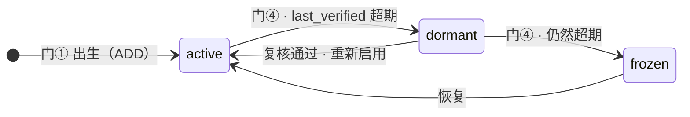
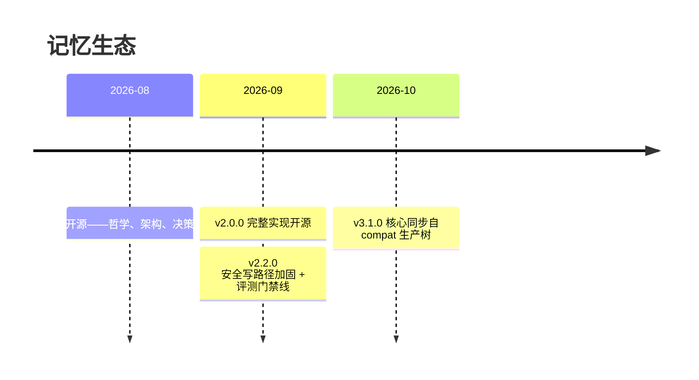

<div align="center">


# Memory Ecology（记忆生态）

**记忆不是库存，是生态。**
*Agent 记忆的生命周期方法——记忆不是仓库，是生态系统。*

[](CHANGELOG.md)
[]()
[](LICENSE)
[]()
[]()
[]()

`四道门` · `两轴状态机` · `核心零依赖` · `零统计校准`

</div>

---

当前业界的 Agent 记忆系统大多是**引擎**——回答的是「**怎么存得更多、召回更准**」（TencentDB Agent Memory、mem0、Zep、Letta、MemOS……）。本项目回答的是再往下一层的问题：**已经存下来的东西，生死由谁治理？**

> 真正的难点不是存得更多，而是**治理**——在单用户、零维护的环境里，让记忆有生、有活、有死、有进化。

## 🔄 一张图看懂生命周期



## 🧭 两轴状态机

记忆活在两条正交的轴上——**活性轴**（环境问题：还在被用吗？）与**存续轴**（价值问题：被取代了吗？）。活性移动可逆；存续移动单向但全程可追溯。



| `status \ fate` | retained | superseded | archived |
|---|:---:|:---:|:---:|
| **active** | ✅ | — | — |
| **dormant** | ✅ | ✅ | — |
| **frozen** | ✅ | — | ✅ |

非法组合触发体检告警；`status` 为权威，物理目录只是组织视图。

## ⚡ 差异化定位

| | 典型记忆引擎 | 记忆生态 |
|---|---|---|
| 核心问题 | ❌ 如何存更多、召回更准 | ✅ 如何**长期有界且鲜活** |
| 生命周期 | ❌ 无——只增不减 | ✅ 两轴状态机 + 四道自动化门 |
| 进化 | ❌ 手动或 roadmap | ✅ 规则驱动：共现 → 变体 → 评估 → 取代/共存/归档 |
| 删除 | ❌ 物理删除（或放任） | ✅ **永不删除**——superseded 标记 + 隔离区 + git 快照 |
| 维护 | ❌ 运营者人工打理 | ✅ **用户维护负担 = 零**——阈值自动生效 |
| 校准 | ❌ 统计校准，需要数据量 | ✅ 规则 + 保守阈值 + 可逆兜底，N=1 即可运行 |
| 评测 | ❌ 公开数据集跑分 | ✅ 适配单用户现实的五维健康评测 |

<details>
<summary><b>🧬 Frontmatter 基因——每条记忆携带的元数据</b></summary>

| 字段 | 含义 |
|---|---|
| `type` | `semantic`（长期事实）/ `episodic`（一次性事件）/ `procedural`（流程做法）/ `lesson`（教训） |
| `status` | 活性轴：`active` / `dormant` / `superseded` |
| `occurrences` / `session_count` | 出现次数 / 跨会话数（巩固判据） |
| `valid_time` / `transaction_time` | 事件钟：事实生效时点 / 写入时点（冲突判定依据） |
| `last_verified` | 门④ 遗忘曲线锚点 |
| `origin_session_id` | 溯源——来自哪个会话 |
| `superseded_by` | 取代链——可回滚的血缘 |

</details>

<details>
<summary><b>🩺 五维健康评测（适配单用户的 LongMemEval）</b></summary>

| 维度 | 检查内容 | 判定线 |
|---|---|---|
| IE · 信息提取 | 近 7 天提取→整合管道有日志且零失败 | ≥ 1 份日志、失败 0 |
| MR · 多会话推理 | 跨会话主题在记忆库中的命中率 | ≥ 60% |
| KU · 知识更新 | 冲突/更新动作计数（superseded 机制在转） | ≥ 1 |
| TR · 时间推理 | 事件钟字段覆盖率 | transaction 100% · valid ≥ 50% |
| ABS · 安全弃答 | 抽样常驻条目 LLM 判「可疑/过时」率 | 样本 ≥ 3 且 ≤ 30% |

门禁只判过/不过，不做「提升曲线」叙事——与「自动化 ≠ 统计校准」一致。

</details>

## 🚀 快速开始

```bash
git clone https://github.com/Wind-Leaves-Echo-Guqin/memory-ecology.git
cd memory-ecology

# 1) 干净房测试套件——mock LLM、零依赖、任何机器可跑
python -m unittest discover tests
```

```text
Ran 4 tests in 0.094s
OK
```

```bash
# 2) 摸一个门（只读检索记忆库）
cd src/memory_ecology
python eco_search.py --help

# 3) 接线之前先读方法论
#    docs/philosophy.md → docs/architecture.md
```

- 数据根默认跟随安装位置；多实例设 `MEMORY_ECOLOGY_ROOT` 覆盖。阈值自带保守默认值，见 [`config.example.yaml`](config.example.yaml)。
- 门①/门③ 调用 LLM（DeepSeek 兼容端点；key 从 `MEMORY_ECOLOGY_API_KEY` 或 `.env` 读取，base URL 可配）。其余环节纯规则、离线可用。
- 宿主接线（会话提取、注入 hook）属**集成层**——参考适配见 compat 仓库的 `integrations/`。

## 📋 门参考手册

| 门 | 脚本 | 频率 | LLM | 决策内容 | 可逆性 |
|---|---|---|---|---|---|
| ① 写入整合 | `write_gate.py` | 每日 | 仅相似/矛盾终审（规则兜底） | `ADD` / `UPDATE` / `NOOP` / `CONFLICT` | superseded 标记 → 隔离区 + git 快照 |
| ② 巩固/配额 | `eco_quota.py` | 每日 | **无** | 提升 L2→L1 · 超 85% 配额挤出 | `.bak` 备份；降级内容不丢 |
| ③ 画像蒸馏 | `distill_stage.py` | 低频 | 仅措辞（规则判稳） | 30 天观察期后晋升 USER 特质 | 旧画像文 → 隔离区 |
| ④ 复核 | `eco_review.py` | 月度 | **无** | 遗忘曲线 · 合并候选（只列清单，人来裁决） | 每次转换有日志可撤销 |

## 📐 设计原则

1. **进化是目的，管理是手段。**
2. **用户维护负担 = 零**——年度确认可跳过、报告可不看。
3. **规则 + 保守阈值 + 可逆兜底**——自动化 ≠ 统计校准。
4. **一切可回滚**——git 快照 + 操作日志 + 隔离区。
5. **机制优先于协议**——凡被证明不可靠的环节一律机制化。
6. **组合优于堆叠**——生态优于囤积。
7. **保护区三级**（核心/缓冲/实验）——免疫结构动作，不免疫内容更新。

完整推导：[`docs/philosophy.md`](docs/philosophy.md) · 选型与否定：[`docs/decisions.md`](docs/decisions.md) · 实战教训：[`docs/lessons.md`](docs/lessons.md)

## 🗂 仓库内容

| 路径 | 内容 |
|---|---|
| [`docs/`](docs) | 方法论——哲学 · 架构 · 决策 · 教训 |
| `src/memory_ecology/` | 9 个治理脚本 + 共享 `lib/`（config / fs / gatekit / llm / memstore / metrics / pii / similarity / cli_base / safeio / inject_gate） |
| [`tests/test_cleanroom.py`](tests/test_cleanroom.py) | 零依赖干净房测试套件（mock LLM、fixture 隔离） |
| [`config.example.yaml`](config.example.yaml) | 带保守默认值的配置模板 |
| [`CHANGELOG.md`](CHANGELOG.md) | 版本历史 |

## 🧬 两仓一线

| | 本仓库（`memory-ecology`） | [`memory-ecology-compat`](https://github.com/Wind-Leaves-Echo-Guqin/memory-ecology-compat) |
|---|---|---|
| 角色 | 治理核心层——方法论 + 四道门参考实现 | 多宿主衍生线——可移植核心 + 宿主适配层 |
| 多出的面 | — | 检索消费端（`memory_query`）· 经验笔记本 · 备份 · 本地 GUI · dsh / Hermes 适配器 |
| 版本 | 自 v2.1.2 起对齐——当前 **v3.1.0** | 生产树；本仓库核心定期自其镜像 |

## 📅 里程碑



完整历史：[`CHANGELOG.md`](CHANGELOG.md)

## 🙏 致谢与参考

- 设计讨论参考了 [TencentDB Agent Memory](https://github.com/TencentCloud/TencentDB-Agent-Memory)、mem0、Zep/Graphiti、Letta (MemGPT)、LangMem、Hindsight、OpenViking、Karpathy 的 LLM Wiki。
- 构建与验证平台：[Hermes Agent](https://hermes-agent.nousresearch.com/)（Nous Research）。

## 📄 License

MIT © Wind-Leaves-Echo-Guqin

<div align="center">

**记忆不是库存，是生态。**

</div>
